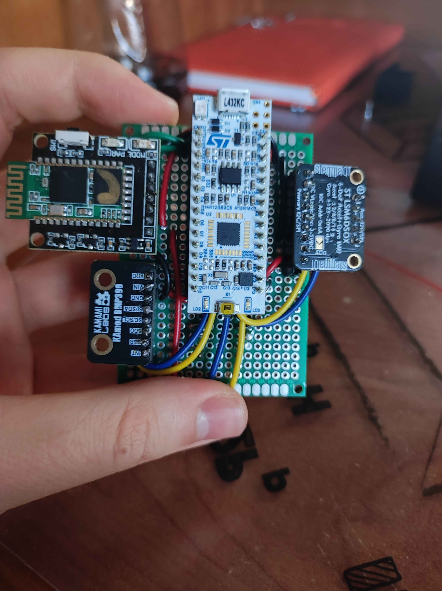
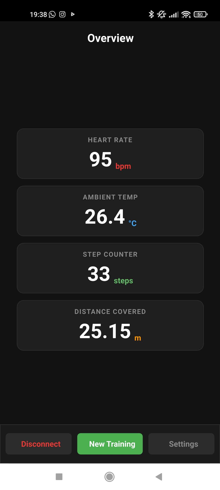
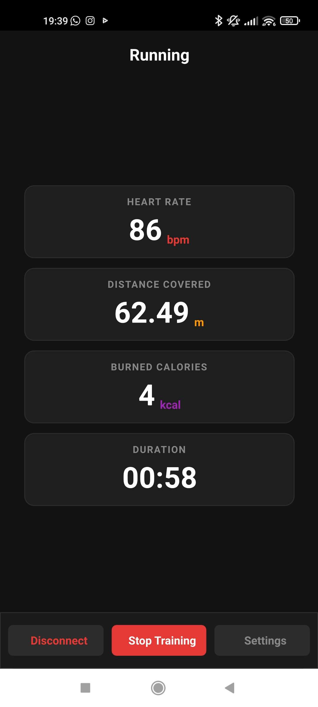

<div align="center">

# VTal Fitness Tracker

**A wearable fitness tracker built from the sensors up - STM32 firmware, hand-assembled hardware, and a live Qt6 dashboard.**

[](https://www.st.com/en/microcontrollers-microprocessors/stm32l432kc.html)
[](https://www.qt.io)
[](LICENSE)



*The assembled device, without its 3D-printed enclosure.*

</div>

## About

VTal is a wearable fitness tracker that measures physical activity and vital signs with three sensors - a **MAX30102** optical pulse oximeter, a **BMP390** barometric pressure sensor and an **LSM6DSOX** 6-axis IMU - built around an **STM32L432KC** microcontroller. The firmware samples each sensor, derives live biometrics from the raw signals, and streams the data over an HC-05 Bluetooth link to a custom desktop application built with **Qt6**, which visualises it in real time.

## Key Features

* **Biometric Monitoring** - real-time pulse oximetry (SpO2) and heart-rate tracking.
* **Environmental and Motion Tracking** - barometric pressure/temperature sensing and a 6-axis IMU.
* **Data Analysis** - calorie and distance counters computed from the acquired biometric and kinematic data.
* **Wireless Telemetry** - serial-over-Bluetooth transmission to the host application.
* **Custom Dashboard** - a Qt6 app that turns the sensor stream into live, readable data (below).

<p align="center">
  
  &nbsp;&nbsp;
  
</p>

<p align="center"><i>The dashboard: live activity overview (left) and an active training session (right).</i></p>

## Hardware Requirements

| Component | Purpose |
| --- | --- |
| NUCLEO-L432KC | Development board (STM32L432KC, Arm Cortex-M4) |
| MAX30102 | Optical SpO2 and heart-rate sensor |
| BMP390 | Barometric pressure and temperature sensor |
| LSM6DSOX | 6-axis IMU (accelerometer + gyroscope) |
| HC-05 | Bluetooth serial module |
| 5V power source | Device supply |
| Custom 3D-printed enclosure | Wearable housing |

## Software Prerequisites

* STM32CubeIDE
* STM32CubeMX
* Qt6

## Repository Structure

```
VTal_App/            Qt6/QML dashboard application
                     (welcome, training choice, dashboard, history and settings screens)
VTal_Data_Reading/   STM32 firmware project (STM32CubeIDE)
docs/images/         Photos and screenshots
```

## Pinout

| Sensor | Bus | Pins | Power |
| --- | --- | --- | --- |
| BMP390 | I2C | A4 (SDA), A5 (SCL) | 3.3 V |
| LSM6DSOX | I2C | A4 (SDA), A5 (SCL) | 3.3 V |
| MAX30102 | I2C | A4 (SDA), A5 (SCL) | 5 V |
| HC-05 | UART | D0 / PA10 (RX), D1 / PA9 (TX) | 5 V |

*Note: All components share a common ground (GND).*

## License

This project is licensed under the **GNU General Public License v3.0** - see the [LICENSE](LICENSE) file for details.
